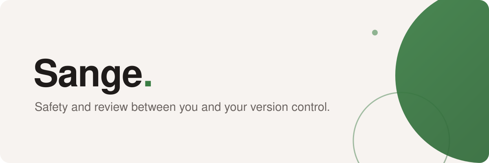

  <a href="https://www.sange.sh">
    <picture>
      <source media="(prefers-color-scheme: dark)" srcset="banner-dark.svg">
      
    </picture>
  </a>

# Where sange started.

Sange is a local-first layer between developers and their version-control
systems. It removes the boilerplate around commits, branches and releases,
enforces the safety rules a team agrees on, and gives a local or self-hosted
dashboard for reviewing and scheduling what goes out. This organisation holds
the original Python implementation, tagged v0.1.0 on 2026-05-14.

It began as one tool doing many jobs. The parts that proved themselves —
identity, file and data checks before anything leaves the machine — are being
rebuilt in Go as a single binary at [sangehq](https://github.com/sangehq), so they
can run anywhere without a Python install. The rest stays here, where the ideas
were first worked out.

This organisation stays public and readable as the reference for that rewrite:
the design notes, the tests and the behaviour the Go version has to match.

## Get in touch

- Following the project: [sange.sh](https://www.sange.sh).
- Security: [security@simtabi.com](mailto:security@simtabi.com) — never a public issue.
  See the [security policy](https://github.com/simsange/.github/security/policy).
- Anything else: [opensource@simtabi.com](mailto:opensource@simtabi.com). A human
  reads it.

Built and maintained by the team at [Simtabi](https://simtabi.com).
